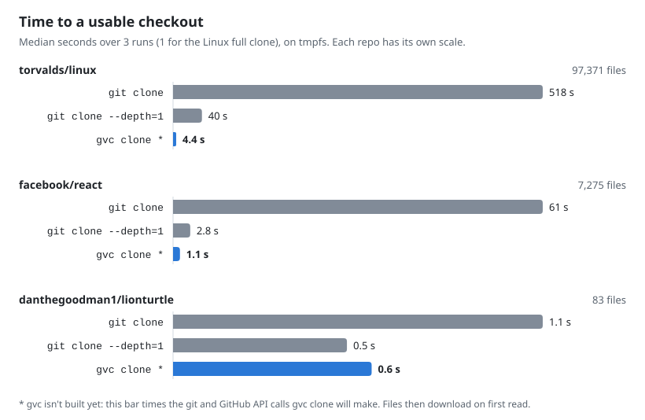
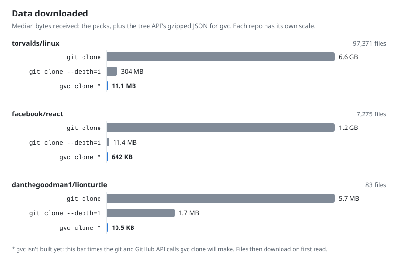

# git-virtual-checkout

`gvc` clones a GitHub repository in seconds at any size, and stock git works inside it. It's built for online agent workloads: many short-lived workspaces, each reading a fraction of a large repository, asking questions of its history, and pushing a change. The working tree is a FUSE mount that lists every file at once and downloads each one the first time something reads it, with your edits in a local layer on top. git keeps its own repository, index and protocol, so `status`, `commit`, `switch`, `merge`, `rebase` and `push` run unmodified.

For the Linux kernel's 97,371 files, the git and API calls that `gvc clone` makes finished in 4.4 s and downloaded 11 MB. `git clone --depth=1` took 40 s and 304 MB, and `git clone` took 8.6 minutes and 6.6 GB. [docs/feasibility.md](docs/feasibility.md) is the design and the experiments behind it, and [PLAN.md](PLAN.md) is the build.

<picture>
  <source media="(prefers-color-scheme: dark)" srcset="docs/images/clone-time-dark.svg">
  
</picture>

**Status: design.** gvc isn't built yet. The experiments in [docs/feasibility.md](docs/feasibility.md) show each piece working against GitHub today, and [PLAN.md](PLAN.md) lays out the phases. A go/no-go gate after the first working checkout replays agent sessions against the best stock setup, and the build goes on only if gvc wins clearly. The gvc numbers on this page time the git and GitHub API calls `gvc clone` will make, run by [`scripts/bench/clones`](scripts/bench/clones).

## How it works

**A clone without the files.** gvc fetches one commit and its trees with no file contents, and every file's size from GitHub's tree API: 11 MB for the Linux kernel, 3.3 MB of trees and 7.7 MB of size listings. Directories list as soon as their trees arrive.

**Files on first read.** The mount answers `ls` and `stat` from memory and fetches a file's contents the first time something reads it: in 20 ms from GitHub's CDN when it's cached, in about 250 ms over the git protocol, and in one batched request when a build reads thousands at once.

**Stock git.** `.git` is a real partial clone. gvc writes the index git trusts, with stat data that matches what the mount reports, and answers git's fsmonitor hook from its own record of writes, so `git status` checks only what changed and never downloads a file you left alone.

**Edits in a local layer.** Writes land in a layer above the commit's tree and survive a crash of the daemon. After `git switch`, `merge` or `rebase`, gvc points the lower layer at the new HEAD and drops local copies that now match it.

**Commits and pushes without history.** git hashes a commit from the blob ids already in the index, so unchanged files never download. A push from a depth-1 partial clone made zero extra fetches in testing.

**History from GitHub.** `gvc log`, `gvc blame`, `gvc show`, `gvc diff` and `gvc merge-base` answer from GitHub's APIs, with no local history and in any checkout of a GitHub repository. GitHub's blame of git/git's Makefile matched `git blame` on all 4,146 lines in 3.7 s. Unpushed commits come from the local repository.

**History for stock git.** Each clone fetches its last 20 generations of commits in the background (546 commits and 512 KB for Linux), so `git log -n` runs locally. Past that, a lazy object store serves commits, trees and blobs as git reads them, and planners batch what `git log` and `git blame` will read: blame of git/git's Makefile took 3 s with the batch, against 282 s fetching one object at a time.

**Git LFS without smudging.** LFS files read as their content, sized from the pointer and fetched by byte range, with no git-lfs install. gvc cleans new LFS files on `git add` and uploads their objects on push.

**Worktrees and switches in one step.** `gvc worktree add` mounts another tree and `gvc switch` swaps the lower layer; both share one object cache and download nothing up front.

**One portable core.** The filesystem logic is platform-neutral Rust behind one trait. FUSE serves it on Linux, and an FSKit extension, a Swift shim over the same crates, will serve it on macOS.

## Performance

These runs used an Intel Core Ultra 9 285 (24 threads, 125 GB) on a home connection, with every clone on tmpfs so the disk drops out. Each figure is the median of three runs, except the Linux full clone, which ran once. [BENCHMARKS.md](BENCHMARKS.md) has the method and the commands.

| Repo | Files | Method | Time | Downloaded | On disk |
|---|--:|---|--:|--:|--:|
| torvalds/linux | 97,371 | `git clone` | 518 s | 6.6 GB | 8.3 GB |
| torvalds/linux | 97,371 | `git clone --depth=1` | 40 s | 304 MB | 2.0 GB |
| torvalds/linux | 97,371 | `gvc clone` | 4.4 s | 11.1 MB | 3.4 MB |
| facebook/react | 7,275 | `git clone` | 61 s | 1.2 GB | 1.2 GB |
| facebook/react | 7,275 | `git clone --depth=1` | 2.8 s | 11.4 MB | 53.1 MB |
| facebook/react | 7,275 | `gvc clone` | 1.1 s | 642 KB | 308 KB |
| danthegoodman1/lionturtle | 83 | `git clone` | 1.1 s | 5.7 MB | 8.1 MB |
| danthegoodman1/lionturtle | 83 | `git clone --depth=1` | 0.5 s | 1.7 MB | 4.1 MB |
| danthegoodman1/lionturtle | 83 | `gvc clone` | 0.6 s | 10.5 KB | 33.1 KB |

The gvc rows end when gvc has every path and size. A stock clone ends with every file on disk; under gvc, each file costs one fetch the first time it's read.

<picture>
  <source media="(prefers-color-scheme: dark)" srcset="docs/images/clone-data-dark.svg">
  
</picture>

GitHub's server time dominates the Linux bootstrap and varied across runs: 4.1 s, 4.4 s and 8.4 s. For a repository as small as lionturtle, a shallow clone is as fast, since both come down to a round trip or two.

### Trade-offs

- **First reads cost a fetch.** 20 to 250 ms for one file; a burst of reads shares one request.
- **Readers of every file download every file.** `rg`, IDE indexers and builds read what they read. `gvc hydrate` streams the whole tree at tarball speed.
- **Offline,** a file never read fails with `EIO`.
- **`git checkout <rev> -- <path>` fetches one blob per file.** In testing, one kernel directory took 338 fetches in 300 s. `gvc prefetch` batches them first.
- **Stock git history past the recent window.** `git log -- <path>`, `blame` and `merge-base` stop at the shallow boundary until the lazy object store serves them; gvc's own history commands have no such limit.
- **Each syscall on a file never edited passes through the daemon.** Edited and hydrated files use FUSE passthrough.
- **Linux first.** macOS follows through FSKit; Windows isn't planned.
- **GitHub first.** The backend speaks the git protocol any host serves, with GitHub's APIs as accelerators; GitLab or Gitea comes next.

## Quick start

The planned interface:

```console
gvc clone https://github.com/torvalds/linux
cd linux
git status
gvc log -n 5 -- kernel/fork.c                # answered by GitHub, no local history
gvc blame -L 100,140 kernel/fork.c
git switch -c fix && $EDITOR kernel/fork.c && git commit -am "Fix fork" && git push -u origin fix
gvc worktree add ../linux-review origin/master
gvc unmount
```

## Compared with

| | gvc | `git clone --filter=blob:none` | Scalar | VFS for Git | EdenFS |
|---|---|---|---|---|---|
| git client | Stock git | Stock git | Stock git, since 2.38 | The `microsoft/git` fork | Sapling; the git CLI knows nothing of it |
| Files at clone | Every file listed, fetched on first read | Every file downloaded at checkout | The sparse cone's files, downloaded | Every file listed, fetched on first read | Every file listed, fetched on first read |
| Server | Any git host with partial clone; GitHub's APIs as accelerators | Any git host with partial clone | Any with partial clone; the GVFS protocol on Azure Repos | The GVFS protocol, on Azure Repos | Sapling's servers |
| History | In the background, or on demand | Commits and trees at clone | Commits and trees at clone | Hourly prefetch packs | Server-side |
| `git status` | Only what changed, from the write log | Stats every file | Only what changed, with fsmonitor | The modified-paths list | Unaware of EdenFS |
| Platforms | Linux; macOS through FSKit planned | All | All | Windows | Linux, macOS, Windows |

## Documentation

- [docs/feasibility.md](docs/feasibility.md): the design, every experiment behind it, and the prior art.
- [PLAN.md](PLAN.md): the phases, their gates, and the evidence for each.
- [BENCHMARKS.md](BENCHMARKS.md): the clone baselines, how they ran, and the commands to reproduce them.

## Development

The scripts need git, Python 3, `bc`, and `gh` signed in (or `GITHUB_TOKEN` set).

```console
scripts/bench/clones --work /dev/shm --out docs/bench/clones.jsonl \
  danthegoodman1/lionturtle facebook/react torvalds/linux   # the clone baselines, on tmpfs
scripts/bench/charts                                         # the README's charts and table
python3 docs/experiments/recon_commit.py git git <sha>       # rebuild a commit from GraphQL and check its hash
```
